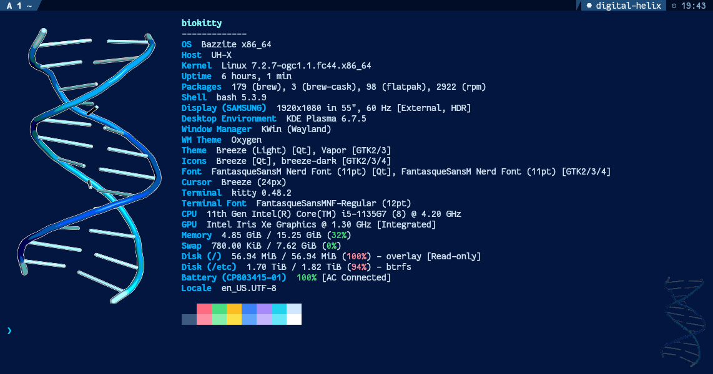
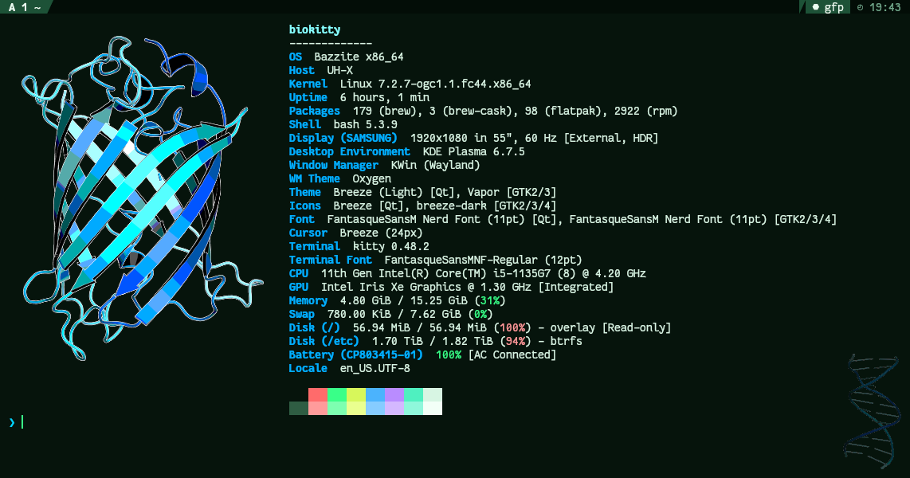
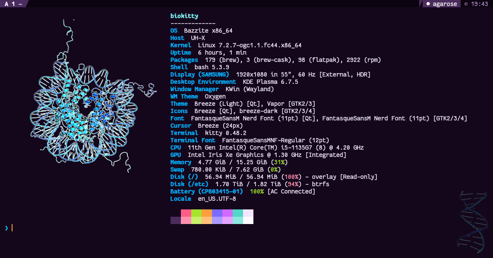
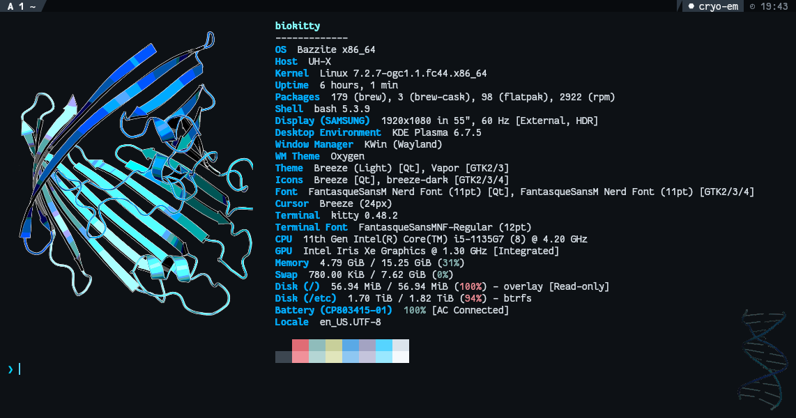
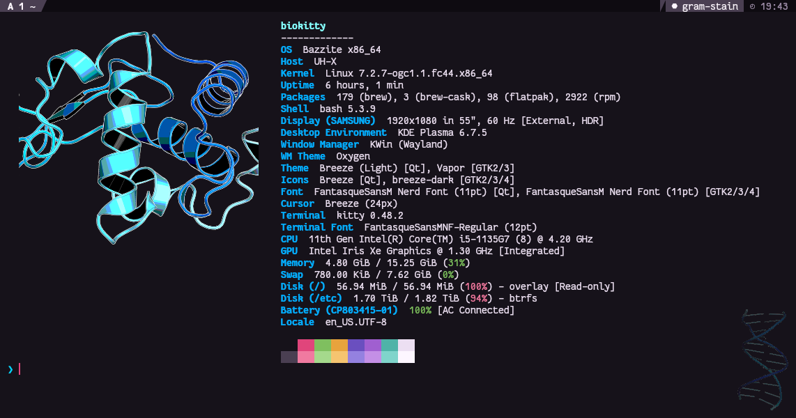
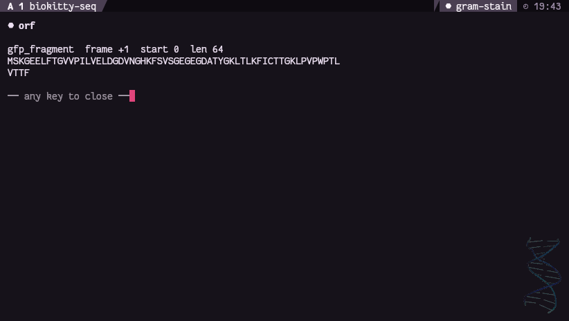
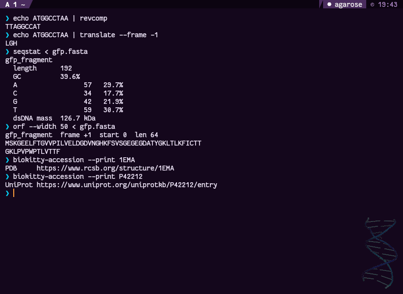

# biokitty

A [kitty](https://sw.kovidgoyal.net/kitty/) terminal setup that greets you with molecular biology instead of a distro logo — real images drawn through kitty's graphics protocol, picked at random each time you open a window — and then keeps being a biology terminal after the banner scrolls away.

<p align="center">
  
  
</p>

**Contents:** [Requirements](#requirements) · [Install](#install) · [Usage](#usage) · [Themes](#themes) · [Keybindings](#keybindings) · [Sequence tools](#sequence-tools) · [Identifier lookup](#identifier-lookup) · [Adding your own logo](#adding-your-own-logo) · [Configuration](#configuration) · [Troubleshooting](#troubleshooting) · [Layout](#layout) · [License](#license)

---

## What this is

A set of configs that wire six things together:

- **kitty** — themed five ways, all sampled from lab imagery, switchable live
- **a nucleotide tab bar** — tabs labelled A, T, G, C with a status readout
- **fastfetch** — system info, with the distro logo replaced by a molecule
- **sequence tools** — reverse complement, translate, GC, ORF, on the selection or in a pipeline
- **identifier lookup** — pick a PDB or UniProt ID off the screen, open its database page
- **a bash hook** — picks a logo at random when a kitty window opens, and stays out of the way everywhere else

Five logos ship with it, each rendered with PyMOL from a [PDB](https://www.rcsb.org/) structure. Add your own from any PDB ID with one command.

## Logos

| Logo | PDB | What it is |
|---|---|---|
| DNA helix | [`1BNA`](https://www.rcsb.org/structure/1BNA) | B-DNA, the Dickerson–Drew dodecamer: the first crystal structure of a full turn of the double helix. Also used as the window watermark. |
| Nucleosome | [`1KX5`](https://www.rcsb.org/structure/1KX5) | 147 base pairs of DNA wrapped around a histone octamer: how DNA is packed into chromatin. |
| GFP | [`1EMA`](https://www.rcsb.org/structure/1EMA) | Green fluorescent protein, an 11-strand β-barrel with the chromophore inside. |
| Porin | [`2POR`](https://www.rcsb.org/structure/2POR) | A 16-strand β-barrel pore from a bacterial outer membrane. |
| Lysozyme | [`1AKI`](https://www.rcsb.org/structure/1AKI) | Hen egg-white lysozyme, the classic α+β enzyme. |

Each new kitty window picks one at random. The themes are independent of the logo, so any pairing can come up:

<p align="center">
  
  
  
</p>

## Requirements

| | |
|---|---|
| **Linux and bash** | The banner hook and aliases are written for bash, and the helpers use GNU tools, `/proc` and `xdg-open`. macOS and other shells are not supported. |
| **kitty** | ≥ 0.42 for `command_palette` and the newer kittens; ≥ 0.28 for the graphics protocol alone. The [official installer](https://sw.kovidgoyal.net/kitty/binary/) works on any distro, including immutable ones, and needs no root. |
| **fastfetch** | ≥ 2.0. Many distros ship it; otherwise see [installation](https://github.com/fastfetch-cli/fastfetch#installation). |
| **A Nerd Font** | The config asks for `FantasqueSansM Nerd Font`. Grab it from [nerdfonts.com](https://www.nerdfonts.com/font-downloads), or change `font_family` in `kitty/kitty.conf`. The tab bar's powerline separators need it. |
| **Python 3.8+** | For the sequence tools. Standard library only, no packages to install. |
| **PyMOL** | Optional. Renders your own logos with `tools/pdb-logo.py`, and opens `.pdb`/`.cif` files you click. |
| **Pillow** | Optional. Needed only by the logo tools in `tools/` (`pip install --user Pillow`). |
| **ripgrep** | Optional. Enables the `rgh` hyperlinked-grep alias. |

Developed on Bazzite (Fedora Atomic) with KDE Plasma on Wayland, kitty 0.48.2 and fastfetch 2.66–2.68. Nothing in it is distro-specific.

## Install

### 1. Install the prerequisites

**kitty** — the official installer works on every distro, needs no root, and puts kitty in `~/.local/kitty.app`:

```bash
curl -L https://sw.kovidgoyal.net/kitty/installer.sh | sh /dev/stdin
mkdir -p ~/.local/bin
ln -sf ~/.local/kitty.app/bin/kitty ~/.local/kitty.app/bin/kitten ~/.local/bin/
```

**fastfetch** — from your package manager:

```bash
sudo dnf install fastfetch        # Fedora
sudo apt install fastfetch        # Debian 13+ / Ubuntu 24.10+
sudo pacman -S fastfetch          # Arch
brew install fastfetch            # Homebrew on Linux (handy on immutable distros)
```

**The Nerd Font** — no root needed:

```bash
mkdir -p ~/.local/share/fonts/NerdFonts && cd ~/.local/share/fonts/NerdFonts
curl -LO https://github.com/ryanoasis/nerd-fonts/releases/latest/download/FantasqueSansMono.tar.xz
tar -xf FantasqueSansMono.tar.xz && rm FantasqueSansMono.tar.xz
fc-cache -f
fc-list | grep -i "FantasqueSansM Nerd Font"   # should print several lines
```

**Optional** — `pymol` (to open structures and render your own logos) and `ripgrep` (for `rgh`), from the same package manager.

### 2. Run the installer

```bash
git clone https://github.com/y-v-j/biokitty.git
cd biokitty
./install.sh --dry-run     # preview: lists every file it would write, changes nothing
./install.sh
```

The installer:

- copies the kitty config, themes, tab bar and sequence engine into `~/.config/kitty/`
- copies the banner configs and logo images into `~/.config/fastfetch/`
- puts `biokitty-theme`, `biokitty-seq` and `biokitty-accession` into `~/.local/bin/`
- appends one marked block to `~/.bashrc` (the banner hook, aliases and sequence functions)

Anything it would overwrite is first backed up to `<file>.bak-<timestamp>`, and re-running it is safe — unchanged files are not backed up again, and the `~/.bashrc` block is only added once.

**The keybindings call the helper commands by bare name, so `~/.local/bin` has to be on your `PATH`.** The `~/.bashrc` block adds it if it is missing.

### 3. Open a new kitty window

Close any open kitty windows and start a new one; the banner draws on the first prompt. To check the pieces individually:

```bash
python3 ~/.config/kitty/kittens/biotools.py selftest   # ok: 0 failure(s)
biokitty-accession --selftest | tail -1                # ok: 0 failure(s)
biokitty-theme                                         # lists the five themes, * marks the active one
echo ATGGCCTAA | revcomp                               # TTAGGCCAT
```

### Updating

Pull the new version and reinstall. Uninstalling first refreshes the `~/.bashrc` block, which a plain re-run leaves alone:

```bash
git pull
./install.sh --uninstall && ./install.sh
```

Then press `ctrl+shift+f5` in any open kitty window to reload its config, or open a new one.

### Uninstall

```bash
./install.sh --uninstall
```

This removes the `~/.bashrc` block and the three helper commands. Config files under `~/.config/kitty` and `~/.config/fastfetch` are left in place, and the command lists the backups it finds so you can restore your previous setup by hand.

---

## Usage

### The banner

Every new kitty window or tab shows system info beside one of the five logos, picked at random. Nested shells inside an existing window don't repeat it, and other terminals never show it. To see a specific one on demand:

```bash
/usr/bin/fastfetch -c ~/.config/fastfetch/config-nucleosome.jsonc
```

### Working on a sequence on screen

1. Select a sequence with the mouse: raw bases, a FASTA record, or a numbered alignment line all work.
2. Press `ctrl+shift+b`, release, then press the operation key — `r` reverse complement, `t` translate, `o` longest ORF, `s` stats.
3. The result opens in an overlay on top of the window. Press any key to close it.

`ctrl+shift+b` then `shift+s` runs stats on everything on screen, with no selection needed. `ctrl+shift+b` then `y` copies the bare sequence, with headers and line numbers stripped, to the clipboard. The full list is under [Keybindings](#ctrlshiftb--biology).

### The same operations in a pipeline

```bash
echo ATGGCCTAA | revcomp                 # TTAGGCCAT
translate --frame 2 < cds.fasta          # frames 1..3, or -1..-3 on the reverse strand
seqstat < reads.fasta                    # length, GC%, composition per record
orf < gene.fna                           # longest ATG..stop peptide in all six frames
```

See [Sequence tools](#sequence-tools) for every command and option.

### Opening a database entry

Press `ctrl+shift+b` then `a`: every identifier on screen (PDB, UniProt, RefSeq, Ensembl, GEO, SRA and more) gets a hint letter. Type the letter to open that entry in your browser. From the shell:

```bash
biokitty-accession 1EMA              # opens the RCSB page
biokitty-accession --print P42212    # prints the URL instead
```

### Highlighting

`ctrl+shift+m` then `n` highlights every run of 12 or more nucleotides on screen, `f` FASTA headers, `e` errors and warnings. Press the same keys again to clear, or `ctrl+shift+m` then `0` to clear everything.

### Changing the theme

```bash
biokitty-theme              # list the five themes
biokitty-theme agarose      # switch every open kitty window now
```

Or press `ctrl+shift+a` then `n` to cycle through them. The theme is independent of the banner logo.

---

## Themes

Five palettes, each sampled from something you would actually see in a lab.

| Slug | Looks like |
|---|---|
| `digital-helix` | Deep navy with a blue-to-cyan ramp. Matched to the logo palette so the artwork sits on the background rather than floating in a rectangle of the wrong blue. **Default.** |
| `gfp` | The 1EMA chromophore at 509 nm on near-black: almost nothing in the background, everything in the signal. Pairs with the GFP banner. |
| `agarose` | A 1% gel on a UV transilluminator — violet-black, bands glowing ethidium orange. |
| `gram-stain` | Crystal violet and safranin. Purple for structure, pink for anything that needs attention. |
| `cryo-em` | Cold greyscale with just enough cyan to find the cursor. The quiet one, for long reading sessions. |

```bash
biokitty-theme                 # list them, marking the active one
biokitty-theme gfp             # switch
biokitty-theme helix           # substring match — picks digital-helix
biokitty-theme random
biokitty-theme --next          # cycle
```

Switching writes `~/.config/kitty/active-theme.conf` (so it survives a restart) **and** pushes the colours into every running window over kitty's remote-control socket, so it takes effect instantly. If the socket is unreachable the theme is still written and applies to the next window you open — the command tells you which happened.

`ctrl+shift+a>n` cycles and `ctrl+shift+a>r` randomises without leaving the keyboard. The active theme's name shows in the top-right of the tab bar.

> Remote control is set to `socket-only`, not `yes`. The switcher can drive kitty over the socket, but a program that merely happens to be running in the terminal cannot control it by writing escape codes to stdout.

> **The socket address is not what you configure.** `listen_on unix:@biokitty` becomes `@biokitty-<pid>` at runtime — kitty appends its own PID, so every instance has a different address and there is no fixed one to connect to. `biokitty-theme` uses `$KITTY_LISTEN_ON` when it is running inside kitty, and otherwise reads the live addresses out of `/proc/net/unix`, which is also how it manages to recolour several open kitty windows at once. Worth knowing if you write your own `kitten @` scripts against this config.

## Keybindings

kitty's own defaults are kept. Everything added sits under four leaders — press one and wait, and kitty shows you the options.

### `ctrl+shift+b` — biology

Each of these runs on the current selection and shows the result in an overlay.

<p align="center">
  
</p>

| Key | Does |
|---|---|
| `r` / `c` | reverse complement / complement |
| `t` | translate, frame 1 |
| `1` `2` `3` | translate in a specific frame |
| `o` | longest open reading frame across all six frames |
| `s` | stats — length, GC%, composition, mass |
| `shift+s` | stats on the **whole screen**, not just the selection |
| `w` | rewrap to 60 columns |
| `y` | copy the bare sequence (headers and numbers stripped) to the clipboard |
| `a` | pick an identifier off the screen → open its database page |
| `p` | same, PDB IDs only |
| `d` | same, DOIs and PubMed IDs |

### `ctrl+shift+k` — kittens

`t` themes · `f` choose\_fonts · `u` unicode\_input · `b` broadcast · `s` show\_key · `q` query\_terminal · `r` resize\_window · `c` choose\_files · `h` hyperlink hints · `w` word hints · `l` line hints · `n` line-number hints · `P` command palette · `d` diff in a new OS window

The kittens that are commands rather than pickers get shell aliases instead: `icat`, `kdiff`, `kssh`, `kclip`, `ktransfer`, `kask`, `kfonts`, `kthemes`, `kpanel`, `kquick`, `knotify`, `kquery`, `khints`, and `rgh` when ripgrep is installed.

### `ctrl+shift+m` — marks

Highlight every occurrence of a pattern on screen. Press again to clear.

`n` nucleotide runs (≥12 chars) · `f` FASTA headers · `a` identifiers · `e` errors and warnings · `q` FASTQ quality trouble · `j`/`k` jump between hits · `0` clear all

> The nucleotide pattern requires 12 characters precisely so ordinary English words made of a/c/g/t — "cat", "tag", "gattaca" — do not light up.

### `ctrl+shift+a` — appearance

`n` next theme · `r` random theme · `t` theme browser. kitty's own `m`/`l`/`1`/`d` opacity controls stay on this leader.

### Two displaced defaults

`ctrl+shift+b` and `ctrl+shift+k` were `move_window_backward` and `scroll_line_up`. Both move to `ctrl+alt+b` and `ctrl+alt+k` (with `ctrl+alt+j` for scroll down) rather than being dropped.

## Sequence tools

The same operations work in a pipeline. `kittens/biotools.py` reads stdin and writes stdout, handles raw sequence or multi-record FASTA, and has no dependencies beyond the standard library.

```bash
echo ATGGCCTAA | revcomp                 # TTAGGCCAT
echo ATGGCCTAA | translate               # MA*
echo ATGGCCTAA | translate --frame -1    # LGH
seqstat < reads.fasta                    # per-record length, GC%, composition
orf < gene.fna                           # longest ORF in any of six frames
seqclean < messy.txt                     # strip headers, digits, whitespace
```

<p align="center">
  
</p>

It is IUPAC-aware (`ACGTURYSWKMBDHVN` all complement correctly), preserves case, leaves gap characters alone so alignments survive a round trip, and strips line numbers so you can paste straight out of a numbered alignment viewer.

Verify the tables after any edit:

```bash
python3 kittens/biotools.py selftest     # 20 assertions
```

## Identifier lookup

`biokitty-accession` recognises the shape of an identifier and opens the right database. `ctrl+shift+b>a` finds them on screen for you.

| Recognises | Goes to |
|---|---|
| `1EMA`, `4hhb` | RCSB PDB |
| `P0DTC2` | UniProt |
| `NM_000546.6`, `NP_000537` | NCBI Nucleotide / Protein |
| `ENSG00000141510` | Ensembl |
| `GSE12345` · `SRR1234567` · `PRJNA12345` | GEO · SRA · BioProject |
| `GCF_000001405.40` | NCBI Datasets |
| `GO:0006915` · `PF00042` · `IPR001245` | AmiGO · Pfam · InterPro |
| `10.1038/nature12373` · `PMID:31452104` | doi.org · PubMed |
| anything else | NCBI all-database search |

```bash
biokitty-accession --print P0DTC2    # print the URL, open nothing
biokitty-accession --selftest        # check the pattern table
```

The order matters: PDB IDs are only four characters and would shadow half the table, so they are matched last.

## Clicking files

`kitty/open-actions.conf` decides what opens what. `.pdb`/`.cif`/`.mol2` go to PyMOL; `.fasta`/`.fastq` open a stats overlay; `.vcf`/`.bed`/`.gff`/`.sam` open in a pager with wrapping off, because they are all far too wide to read otherwise; images draw inline with `icat`.

```bash
kitten open-actions /path/to/file.pdb    # test a path without clicking
```

## Random logo rotation

Every new kitty window draws one of the installed logos. The rotation lives in the bash hook, and picks from every `config*.jsonc` in `~/.config/fastfetch` except the ASCII fallback:

```bash
_bk_banners=()
for _bk_cfg in "$HOME/.config/fastfetch"/config*.jsonc; do
    [[ $_bk_cfg == */config-ascii.jsonc ]] && continue
    [[ -r "$_bk_cfg" ]] && _bk_banners+=("$_bk_cfg")
done
/usr/bin/fastfetch --config "${_bk_banners[RANDOM % ${#_bk_banners[@]}]}"
```

Each candidate is a **complete fastfetch config**, not just an image path, because every logo needs its own geometry — the DNA helix is tall and narrow (29×26 cells), the protein logos are squatter (about 42×21–24). There is no list to maintain: drop a new `config-<name>.jsonc` in the folder and it joins the rotation; rename one so it no longer ends in `.jsonc` to take it out.

New tabs and windows are spawned by kitty rather than inherited from the shell, so each gets its own draw. Nested shells inside an existing window don't re-trigger it.

## Adding your own logo

### From a PDB structure (recommended)

```bash
./tools/pdb-logo.py 1gzx --name hemoglobin --upright --outdir ~/.config/fastfetch
```

Fetches the structure, renders it in PyMOL with a transparent background and the project palette (proteins blue→pale along the chain; DNA and RNA with a blue→cyan backbone and pale base-pair rungs), pre-scales it, and prints a ready-to-paste config block. Save that as `~/.config/fastfetch/config-hemoglobin.jsonc` — copy `config-porin.jsonc` and swap in the printed `logo` block — and it joins the rotation on the next window. The tool warns if the logo would make the banner wider than the default window; lower `--rows` if it does.

The bundled logos were made with:

```bash
./tools/pdb-logo.py 1bna --name dna-helix  --upright --rows 26 --outdir fastfetch
./tools/pdb-logo.py 1kx5 --name nucleosome --rows 21 --outdir fastfetch
./tools/pdb-logo.py 1ema --name gfp        --upright --outdir fastfetch
./tools/pdb-logo.py 2por --name porin      --rows 24 --outdir fastfetch
./tools/pdb-logo.py 1aki --name lysozyme   --rows 18 --outdir fastfetch
```

Also worth trying: `1gzx` (hemoglobin), `4ins` (insulin), `1mbn` (myoglobin), `6vxx` (SARS-CoV-2 spike).

> Dense structures turn to visual noise at terminal size. A beta barrel survives the downscale far better than a bundle of thin helices — hemoglobin looks superb at poster size and like blue static at 38 columns.

### From an image file

```bash
./tools/make-logo.py ~/Pictures/logo.jpg --outdir ~/.config/fastfetch
```

Converts to PNG, keys the flat background out to transparency, and prints a sized config block. Useful flags: `--rows N`, `--tolerance N`, `--keep-background`.

## Three things that decide whether a logo looks right

Everything below was learned the hard way; the tools now handle it for you.

### 1. kitty cannot display JPEG

The `f=` key of the graphics protocol accepts exactly three values:

| Value | Format |
|---|---|
| `f=24` | raw 24-bit RGB |
| `f=32` | raw 32-bit RGBA |
| `f=100` | PNG |

Point fastfetch at a `.jpg` and kitty parses JPEG bytes as PNG, fails, and renders **nothing at all** — no error, no placeholder, nothing in any log. The layout still reserves the space, so it looks like your config was ignored. If your logo is blank, this is almost certainly why.

### 2. Cells are not square

Terminal cells are about **2.2× taller than wide**, so a box with equal cell counts squashes an image badly:

```
cols = (image_width / image_height) × rows × 2.2
```

`preserveAspectRatio: true` makes fastfetch fit inside the box without stretching — but only when the terminal reports its cell size in pixels. When it can't, the box is used literally, so the numbers need to be right anyway. `pdb-logo.py` computes the box for you.

### 3. Let kitty scale as little as possible

kitty resizes the image into the cell box itself. A large reduction shreds thin features — cel-shading outlines are only a pixel or two wide and turn to jaggies. The bundled GFP logo went from visibly rough to clean by supersampling the render and pre-scaling with Lanczos to **2× its display size**, leaving kitty a clean 2:1 reduction instead of 3:1 from a much larger source.

`pdb-logo.py` does this automatically. If you change font size substantially, regenerate.

## Configuration

`kitty.conf` holds only the font and shell settings; everything else is a separate include, so a change to one area cannot disturb another. Comment out any `include` to drop that layer.

**Font** — `kitty/kitty.conf`:
```conf
font_family        FantasqueSansM Nerd Font
font_size          12.0
```
Leave `modify_font cell_width/cell_height` at `100%`. They stretch the character cell, which skews ASCII art against the info column.

**The DNA watermark** — `kitty/ui.conf`. Every window gets the 1BNA helix ghosted into its bottom-right corner:
```conf
window_logo_path        dna-helix.png
window_logo_alpha       0.06
window_logo_scale       26
```
Both numbers matter. At natural size (`window_logo_scale 0`) the helix is large enough to compete with your text instead of sitting behind it. Set `window_logo_alpha 0` to turn it off.

**Transparency** — also `ui.conf`. `background_opacity 0.94` with `background_blur 32`. KDE honours the blur on Wayland; compositors that don't simply ignore it and you get plain transparency.

**The tab bar** — `kitty/tab_bar.py`. Delete the `tab_bar_style custom` line from `ui.conf` to fall back to kitty's built-in powerline bar; nothing else depends on it.

**Which info rows appear in the banner** — the `modules` array in each fastfetch config. This list is **not optional**: a config with no `modules` key renders the logo and nothing else rather than falling back to defaults. `fastfetch --list-modules` shows what's available. For an icon on a row:
```jsonc
{ "type": "os", "key": " 󰣛" }
```

## Terminals without graphics support

`fastfetch/config-ascii.jsonc` uses a generated ASCII helix and works anywhere:

```bash
fastfetch -c ~/.config/fastfetch/config-ascii.jsonc
```

```
                 0
            0         1
        1010101010101010100
     0                       1
    110101010101010101010101010
     0                       1
        1010101010101010100
            0         1
```

Regenerate it with `tools/gen_dna.py` — it draws two sine-wave backbones 180° out of phase with binary rungs on alternating rows, padding every line to identical width so the info column can't skew. The bundled hook only fires inside kitty, so other terminals stay quiet by default.

## Troubleshooting

| Symptom | Cause |
|---|---|
| Blank space where the logo should be | Source is a JPEG. Convert to PNG. |
| Logo squashed or stretched | Width/height box doesn't match the image aspect. |
| Rough, jagged, "edgy" outlines | kitty is downscaling too far — pre-scale the PNG (see §3 above). |
| Logo in a visible rectangle | The PNG has an opaque background. Render it with `pdb-logo.py`, or run `make-logo.py` without `--keep-background` so the background is keyed out. |
| A stray fragment of text to the left of the info column, under the logo | An info row (usually `Font` or `Theme` on KDE, which list Qt and GTK side by side) is wider than the window and wrapped. Widen the window (`initial_window_width` in `ui.conf`) or delete that row from the config's `modules` list. The protein banners are the widest and hit this first. |
| Only the logo, no system info | The `modules` array is missing from that config. |
| Same logo every time | Only one `config*.jsonc` is installed in `~/.config/fastfetch`. If you installed an earlier biokitty, its `~/.bashrc` block still lists two fixed configs: run `./install.sh --uninstall && ./install.sh` to refresh it. |
| Banner in every terminal, not just kitty | The `$KITTY_WINDOW_ID` guard was dropped. |
| Distro's own fetch config wins | Some distros alias `fastfetch`. Call `/usr/bin/fastfetch` directly. |
| Boxes instead of icons | Nerd Font not installed, or `font_family` points at a non-Nerd build. |
| `ctrl+shift+b` bindings do nothing | `~/.local/bin` is not on `PATH`. Open a new shell. |
| Tab bar blank | `tab_bar.py` raised — check kitty's stderr. Remove `tab_bar_style custom` to fall back. |
| Theme switches but running windows don't change | Remote control socket unreachable. The theme still applies to new windows. |
| Watermark too loud | Lower `window_logo_alpha`, or `window_logo_scale`. |
| `rgh` not found | ripgrep isn't installed; the alias is skipped deliberately. |
| Tab index printed twice | `tab_title_template` contains `{index}` — `tab_bar.py` already draws it. Use `"{title}"`. |

## Layout

```
biokitty/
├── install.sh                    backup-safe installer (--dry-run, --uninstall)
├── LICENSE                       MIT
├── bin/
│   ├── biokitty-theme            switch palette, live, over the kitty socket
│   ├── biokitty-seq              run a sequence op on stdin, hold in an overlay
│   └── biokitty-accession        identifier -> database page
├── kitty/
│   ├── kitty.conf                font, shell, and the includes below
│   ├── ui.conf                   window, tabs, cursor, transparency, DNA watermark
│   ├── keys.conf                 bindings, including every kitten
│   ├── marks.conf                sequence and identifier highlighting
│   ├── diff.conf                 colours for the diff kitten
│   ├── open-actions.conf         what a clicked .pdb or .fasta opens with
│   ├── tab_bar.py                the nucleotide tab bar
│   ├── themes/                   five bio palettes
│   └── sessions/bench.conf       three-pane lab bench layout
├── kittens/
│   └── biotools.py               sequence engine + CLI (has a selftest)
├── fastfetch/
│   ├── config.jsonc              DNA helix banner (default for plain `fastfetch`)
│   ├── config-nucleosome.jsonc   nucleosome banner
│   ├── config-gfp.jsonc          GFP banner (explains every logo field)
│   ├── config-porin.jsonc        porin banner
│   ├── config-lysozyme.jsonc     lysozyme banner
│   ├── config-ascii.jsonc        ASCII banner (portable, not in the rotation)
│   ├── dna-helix.png             1BNA render, also the window watermark
│   ├── nucleosome.png            1KX5 render
│   ├── gfp.png                   1EMA render
│   ├── porin.png                 2POR render
│   ├── lysozyme.png              1AKI render
│   └── dna.txt                   generated ASCII helix
├── shell/biokitty.bashrc         banner hook, kitten aliases, sequence functions
├── tools/
│   ├── pdb-logo.py               PDB ID -> rendered logo + config block
│   ├── make-logo.py              image file -> logo + config block
│   └── gen_dna.py                ASCII helix generator
└── docs/
    ├── screenshot.png            DNA banner (digital-helix theme)
    ├── screenshot-gfp.png        GFP banner (gfp theme)
    ├── screenshot-nucleosome.png nucleosome banner (agarose theme)
    ├── screenshot-porin.png      porin banner (cryo-em theme)
    ├── screenshot-lysozyme.png   lysozyme banner (gram-stain theme)
    ├── screenshot-seqtools.png   sequence tools in a pipeline (agarose theme)
    └── screenshot-overlay.png    ctrl+shift+b overlay (gram-stain theme)
```

The lab bench session is not loaded automatically — it overrides the single-window geometry the banner is sized for. Start it explicitly, or uncomment `startup_session` in `kitty.conf`:

```bash
kitty --session ~/.config/kitty/sessions/bench.conf
```

## Logo sources

Every logo, and the window watermark, is rendered by `tools/pdb-logo.py` from PDB entries [1BNA](https://www.rcsb.org/structure/1BNA), [1KX5](https://www.rcsb.org/structure/1KX5), [1EMA](https://www.rcsb.org/structure/1EMA), [2POR](https://www.rcsb.org/structure/2POR) and [1AKI](https://www.rcsb.org/structure/1AKI). The ASCII helix in `dna.txt` is generated by `tools/gen_dna.py`.

## License

[MIT](LICENSE). Covers the configs, scripts, logo renders and documentation.

## Credits

[kitty](https://github.com/kovidgoyal/kitty) by Kovid Goyal · [fastfetch](https://github.com/fastfetch-cli/fastfetch) · [PyMOL](https://github.com/schrodinger/pymol-open-source) · [RCSB PDB](https://www.rcsb.org/) · [Fantasque Sans Mono](https://github.com/belluzj/fantasque-sans) by Jany Belluz, patched by [Nerd Fonts](https://github.com/ryanoasis/nerd-fonts)
